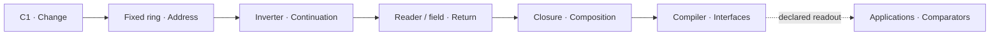

QUHARMONICS RESEARCH GROUP · OPEN RESEARCH CORPUS

# ◈ NEXUS

### The Harmonic Reality Framework

**Constraint is primary. Transformation is the operation. A return path is part of the result.**

[Website](https://quharmonics.com/) · [ORCID](https://orcid.org/0009-0003-3128-8828) · [ResearchGate](https://www.researchgate.net/profile/Dean-Kulik) · [Academia](https://independent.academia.edu/ClaudReins)

**[Interactive portal source](docs/index.html)** · **[Start here](START_HERE.md)** · **[Documentation](docs/)** · **[Mathematical reference](docs/REFERENCE.md)** · **[Research catalog](docs/catalog/)**

> **C1: All things must change.**

NEXUS is an independent research program investigating the growth of computation from lawful transformation: native binary relations, addressing, continuation, closure, reversible reader–field operations and composition. It begins with what a structure requires rather than a search for values that fit an assumed result.

## Choose your entrance

| Reader | Route |
| :-- | :-- |
| First visit | [Start here](START_HERE.md) — seven-paper native dependency path |
| Mathematician | [Mathematical reference](docs/REFERENCE.md) — formulas, contracts and inverses |
| Programmer | [Executable examples](docs/REPRODUCE.md) — native audits and notebooks |
| Systems researcher | [Systems and domains](docs/SYSTEMS.md) |
| Historian | [History and provenance](docs/HISTORY.md) · [Audit Trail](Audit%20Trail/) |
| Specific source | [Complete catalog](docs/catalog/) · [Standalone archive search](docs/archive-search.html) · [JSON](docs/catalog.json) |

The historical catalog indexes **1,140 files** in its pinned source snapshot, including **806 PDFs and 21 notebooks**. The active checkout contains 21 curated notebooks (including the Ring Atlas), the AI kernel audit bundle, documentation and the portal. The bulk historical material remains at the [preserved research revision](https://github.com/QuHarmonics/The-Nexus-Harmonic-Reality/tree/462e8e558eafb9f333b7726eddf0e7a527ee93e1). The historical count is not a count of unique publications. Browse the Markdown indexes directly on GitHub, or follow [portal setup](PORTAL_SETUP.md) to serve the interactive site.

## Native architecture

The [native domain](The%20Nexus%20Domain/) supplies the foundational mathematical reading path. The ring is a fixed address structure; continuation is an operation; retained closure has a return route in the specified complete state.

**WHAT → WHERE → ROUTE → INVERSE.** Begin at the required distinction, resolve existing providers and identify the missing link. The [method contract](METHODS.md) records what an operation requires, returns and preserves.

## Research tools

[Native operations notebook](lab/Nexus_Native_Operations.ipynb) · [Public roadmap](docs/ROADMAP.md) · [Machine-readable research metadata](ro-crate-metadata.json) · [Verification guide](docs/MAINTAINERS.md)

## Browse the research areas

| Research area | Scope |
| :-- | :-- |
| [The Nexus Domain](The%20Nexus%20Domain/) | Native rings, continuation, closure and return |
| [Artificial Intelligence](Artificial%20Inteligence/) | Compiler interfaces and model-assisted computation |
| [Computation](Computation/) | Algorithms and transformation structure |
| [Cryptography](Cryptography/) | SHA-256 and related algebraic and geometric research |
| [Quantum Computation](Quantum%20Computation/) | Phase, reversibility and information |
| [Physics](Physics/) | Physical comparators and models |
| [Biology](Biology/) | Sequence, folding and transformation |
| [Chemistry](Chemistry/) | Molecular and reaction systems |
| [Material Science](Material%20Science/) | Material structure and transformation |
| [Clay Prizes](Clay%20Prizes/) | Mathematical research programs |
| [Audit Trail](Audit%20Trail/) | Historical papers, transcript provenance and corrections |

Some collections are navigation-only pending curation. Earlier papers, notebooks, working sources and corrections remain in their historical addresses rather than being rewritten into one retrospective account.

## Research ledger

| State | Meaning |
| :-- | :-- |
| **STANDS** | Mathematical identity or theorem |
| **RUNS** | Derived route with an executed readout in its stated scope |
| **OPEN** | Required result specified; route or dependency not yet bound |
| **DEAD END** | Landing belongs to another structure |
| **PULL** | External or physical interpretation |

A source reference preserves original derivation, implementation and observed result. External interpretation does not silently replace a native operation.

## Publications and provenance

The [public research archive](https://drive.google.com/drive/folders/1MQePNhpBUV-9UVLTq1CIOixxYLg3RgLq?usp=sharing) complements GitHub. Cite the paper and DOI/version where supplied; [repository citation metadata](CITATION.cff) is available.

This living record was developed with AI systems as collaborators in analysis, implementation and drafting. The complete chronology, systems census and minimal method-to-ring dependency map remain under construction.

## Attribution and reuse

**Dean A. Kulik · QuHarmonics Research Group**  
ORCID [0009-0003-3128-8828](https://orcid.org/0009-0003-3128-8828)

**Research first.** Independent researchers, students, educators and noncommercial builders are the intended first beneficiaries of NEXUS. The [QuHarmonics Research-First Licensing Policy](LICENSE.md) explains the planned licensing model, existing grants and commercial permission route. Existing file-specific terms remain in force; a public file without a license notice is not automatically licensed for reuse.

[Copyright and attribution](COPYRIGHT.md) · [AI research disclosure](AI_DISCLOSURE.md) · [Research provenance](PROVENANCE.md) · [Third-party notices](THIRD_PARTY_NOTICES.md) · [Research disclaimer](DISCLAIMER.md) · [Contributing](CONTRIBUTING.md) · [Security](SECURITY.md)

---

**A traceable program of derivation, execution, correction, and continuation.**

*Driven by Dean A. Kulik · QuHarmonics Research Group*

