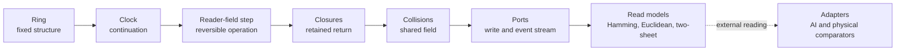

<div align="center">

<sub>QUHARMONICS RESEARCH GROUP · OPEN RESEARCH CORPUS</sub>

# ◈ NEXUS

### The Harmonic Reality Framework

**Constraint is primary. Transformation is the operation. A return path is part of the result.**

A living research program exploring computation as a self-organizing, reversible process—across binary mathematics, software architecture, information, geometry, and physical interpretation.

[](https://quharmonics.com/)
[](https://www.researchgate.net/profile/Dean-Kulik)
[](https://independent.academia.edu/ClaudReins)
[](https://orcid.org/0009-0003-3128-8828)

**[Start with the core](The%20Nexus%20Domain/)** · **[Explore research areas](#browse-the-research-areas)** · **[Public Drive archive](https://drive.google.com/drive/folders/1MQePNhpBUV-9UVLTq1CIOixxYLg3RgLq?usp=sharing)**

</div>

---

> **C1: All things must change.**
>
> NEXUS follows that constraint from the smallest reversible operation outward. The question is not which values fit a model; it is which relationships, routes, inverses, and observables are required by the structure itself.

## What is NEXUS?

NEXUS is a long-running, independently developed research framework built around a different starting point: **begin with lawful transformation, not a catalog of static objects**. The work asks what a finite system can do, what it must preserve, how a reader encounters its own history, and how a result finds its way back.

The project spans several connected layers:

| Layer | Central question | Examples of work |
|:--|:--|:--|
| **Native binary rings** | How do reversal, complement, comparison and address determine a fixed space of possible relationships? | Partner involutions, seam geometry, nested rings |
| **Clock and continuation** | What happens when the smallest fixed-point-free operation must continue? | One Inverter, loop parity, twisted returns |
| **Retained continuation** | How does a reader carry and revisit the consequences of earlier steps? | Reader–field machine, exact inverse, three closure classes |
| **Collision and composition** | What can interacting readers exchange or conserve without selecting a privileged execution order? | Joint XOR writes, lamp alignment, conserved charge |
| **NEXUS AI / compiler** | Can a requirement be bound to a derived reversible route instead of a guessed candidate? | BIND, proof providers, switch-tape reconstruction |
| **Applications and comparators** | Where do these operators provide useful readings in other domains? | SHA-256, prime structures, spectral problems, atomic shells, physics models |

The distinction between these layers matters. An algebraic identity, an independently executed result, and a proposed reading in physics are **not interchangeable claims**.

## The working principle

```text
WHAT must exist  →  WHERE can read it  →  ROUTE binds them  →  INVERSE finds the way home
```

Rather than generating candidates until a readout looks convincing, the method starts from the constraint at the gap, subtracts what existing routes already account for, and asks which missing link is forced by the neighboring structure. Programs then check the derived route against execution.

### The research ledger

| Label | Meaning |
|:--|:--|
| **STANDS** | A mathematical identity or theorem supplies the result. |
| **RUNS** | A route was specified and an execution landed there; its test scope is stated. |
| **OPEN** | The required result is specified, but a derivation or dependency link is missing. |
| **DEAD END** | An execution landed elsewhere; the result must be routed to its actual owner. |
| **PULL** | A physical or external interpretation, kept distinct from the domain proof. |

Predictions, source code, correction logs, and execution traces are retained where available. A later paper may refine—or supersede—an earlier reading without erasing the development record.

## Where to start

**Start with the native machine, not the archive.** The [NEXUS Domain](The%20Nexus%20Domain/) contains the rings-forward research path. Its [published papers](The%20Nexus%20Domain/Published%20Papers/) include *Only Addressable*, *Against Its Own Reverse*, *One Inverter*, *Retained Continuation*, and *Exact Algebra of Retained Continuation*.

Explore the [nine research areas](#browse-the-research-areas) by subject. Each area is organized the same way—**Published Papers, Code, Markdown, Transcripts**—so papers, working sources, implementations and research history have clear roles.

For the broader historical corpus and earlier investigations, use the [public Google Drive archive](https://drive.google.com/drive/folders/1MQePNhpBUV-9UVLTq1CIOixxYLg3RgLq?usp=sharing). The current GitHub tree is a curated structure, not a complete copy of every old working file.

## A center-out picture



The native step is the core operation. Adapters observe it through declared interfaces rather than changing its laws to force an external match.

## Browse the research areas

The repository is now organized by **research domain**, not file age or format. Each area has dedicated sections for **Published Papers · Code · Markdown · Transcripts**. Sections may begin as empty, documented entry points; content is added deliberately.

| Research area | Scope |
|:--|:--|
| [**The Nexus Domain**](The%20Nexus%20Domain/) | The native machine: structure, continuation, memory, closure, and return. |
| [**Artificial Inteligence**](Artificial%20Inteligence/) | AI as an interface to a deterministic, auditable compiler. |
| [**Computation**](Computation/) | Algorithms read as reversible transformations and constrained routes. |
| [**Cryptography**](Cryptography/) | SHA-256 and related systems studied through algebra, carries, and geometry. |
| [**Physics**](Physics/) | Physical comparators for a domain defined without physical constants. |
| [**Quantum Computation**](Quantum%20Computation/) | Reversibility, phase, operator structure, and information flow. |
| [**Biology**](Biology/) | Constraint, sequence, and return paths in living systems. |
| [**Chemistry**](Chemistry/) | Patterns of transformation in molecular and reaction systems. |
| [**Material Science**](Material%20Science/) | Structure, defects, phases, and the cost of transformation. |

**Start here:** [The Nexus Domain](The%20Nexus%20Domain/) is the foundational layer. The other subjects are related constructions and applications; they should not be mistaken for the core's proof obligations.

## Publications, notebooks, and raw history

NEXUS was developed through iterative, high-velocity exploration. The papers are milestones of that unfolding, not a claim that every earlier draft is the current formulation. Earlier work, failed routes, correction logs, code, notebooks, and AI-assisted research dialogue are part of the traceable record; some remain in Git history or the linked Drive archive rather than the current curated tree.

- **Published record:** use the paper's permanent DOI/Zenodo entry when citing a specific version.
- **Executable record:** code and traces show exactly which inputs and domains were checked.
- **Working record:** experiments and draft ideas are retained without being presented as completed results.
- **Historical record:** superseded files remain available to show how the architecture changed.

## People and links

**Research:** Dean A. Kulik · **QuHarmonics Research Group**  
**ORCID:** [0009-0003-3128-8828](https://orcid.org/0009-0003-3128-8828)

| Platform | Access |
|:--|:--|
| Website | [quharmonics.com](https://quharmonics.com/) |
| Public research archive | [Google Drive — NEXUS files](https://drive.google.com/drive/folders/1MQePNhpBUV-9UVLTq1CIOixxYLg3RgLq?usp=sharing) |
| Research profile | [Academia.edu — Dean Kulik](https://independent.academia.edu/ClaudReins) |
| Research profile | [ResearchGate — Dean Kulik](https://www.researchgate.net/profile/Dean-Kulik) |
| Author identity | [ORCID](https://orcid.org/0009-0003-3128-8828) |
| Source repository | [GitHub — QuHarmonics](https://github.com/QuHarmonics/The-Nexus-Harmonic-Reality) |
<!-- Add official QuHarmonics Facebook page here once the exact URL has been supplied/verified. -->

## Attribution and reuse

Research and original framework by **Dean A. Kulik, QuHarmonics Research Group**. AI systems have been used as collaborators in analysis, implementation and drafting; the research ledger records what was derived and what was executed.

Many manuscripts carry **CC BY-NC 4.0** notices. Check each file's own license and attribution statement. **The repository currently has no single blanket software license**; publishing a source file does not by itself establish reuse rights for every component. A repository-wide licensing policy will be set during consolidation.

---

<div align="center">

**Not a frozen theory. A traceable program of derivation, execution, correction, and continuation.**

*Driven by Dean A. Kulik · QuHarmonics Research Group*

</div>
